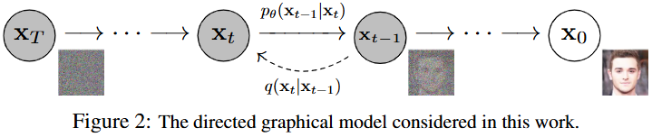
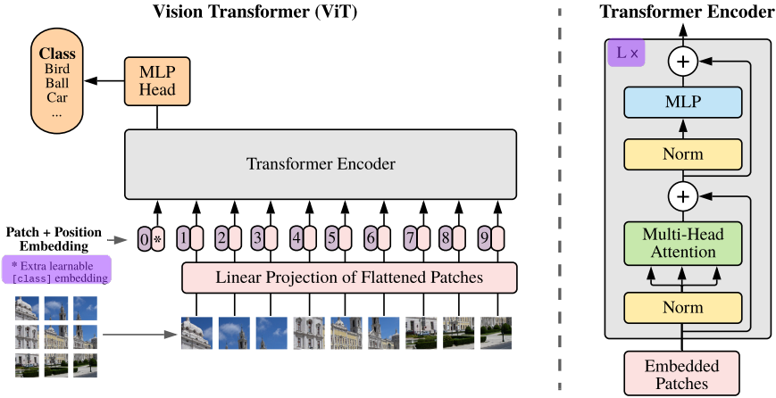
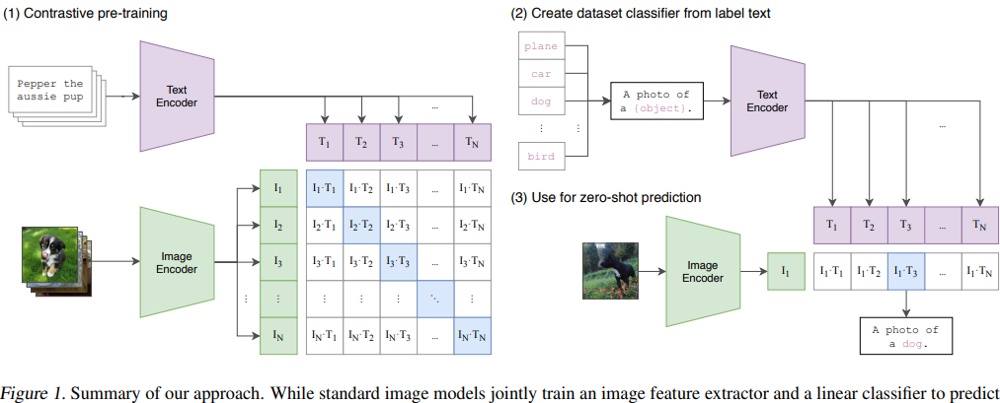
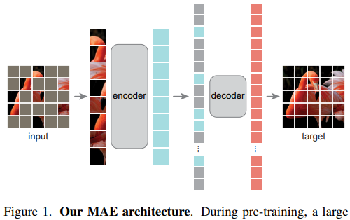
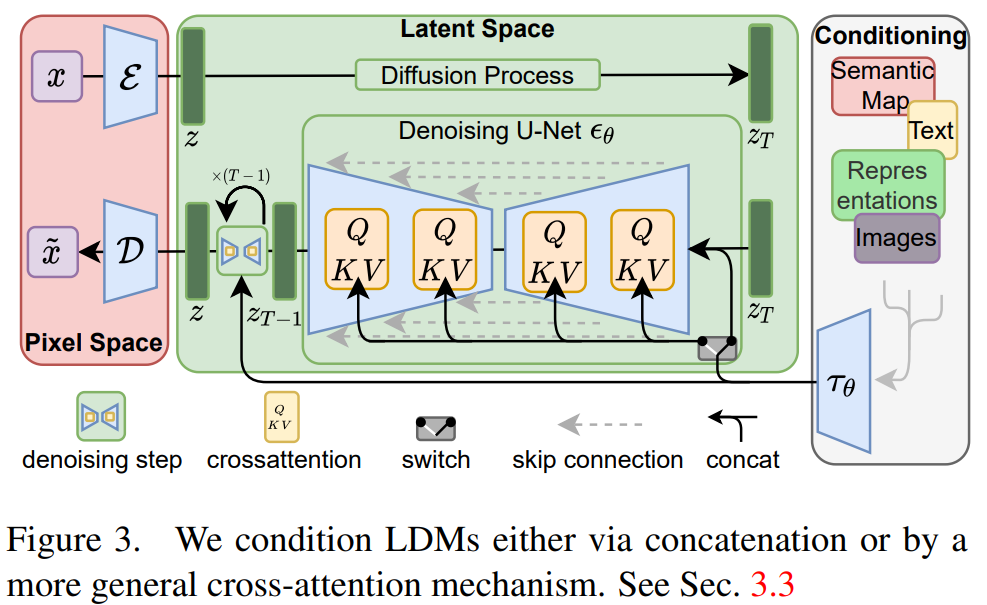
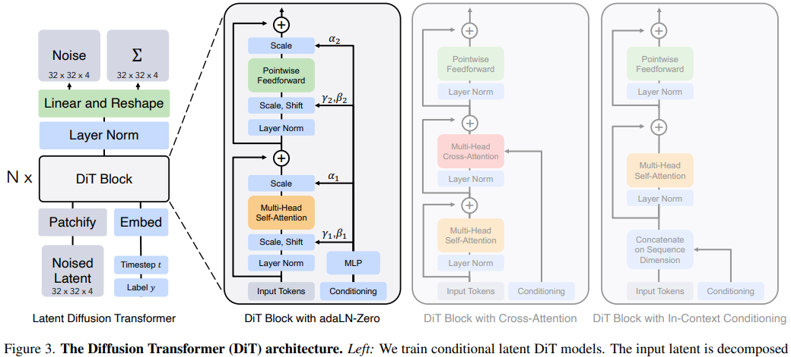

Here are 8 essential computer vision papers that trace the evolution of modern computer vision and generative modeling, from structured latent representations to transformer-based generation.

1. [Variational Autoencoder (VAE) (2013)](https://arxiv.org/abs/1312.6114)
2. [Denoising Diffusion Probabilistic Models (DDPM) (2020)](https://arxiv.org/abs/2006.11239)
3. [Vision Transformer (ViT) (2020)](https://arxiv.org/abs/2010.11929)
4. [Contrastive Language-Image Pretraining (CLIP) (2021)](https://arxiv.org/abs/2103.00020)
5. [Classifier-Free Guidance (CFG) (2021)](https://arxiv.org/abs/2207.12598)
6. [Masked Autoencoder (MAE) (2021)](https://arxiv.org/abs/2111.06377)
7. [Latent Diffusion Models (LDM) (2022)](https://arxiv.org/abs/2112.10752)
8. [Diffusion Transformer (DiT) (2022)](https://arxiv.org/abs/2212.09748)

Modern computer vision and generative modeling evolved through a series of connected breakthroughs. In 2013, the Variational Autoencoder (VAE) introduced probabilistic latent-variable modeling and the Evidence Lower Bound (ELBO), giving researchers a practical way to learn continuous representations. Rather than mapping an image to a single fixed vector, a VAE models its latent representation as a distribution—a perspective that later helped make latent-space generation possible.

In 2020, Denoising Diffusion Probabilistic Models (DDPM) recast image generation as a gradual process of adding and then removing noise. Diffusion models offered stable training and high-quality results, but their many sequential denoising steps were computationally expensive. Around the same time, the Vision Transformer (ViT) showed that images could be processed as sequences of patches. Masked Autoencoders (MAE) later built on this idea, learning visual representations by reconstructing masked patches from unlabeled images.

Two other advances made diffusion models more controllable. CLIP learned a shared representation for images and natural language, allowing text to guide generation. Classifier-Free Guidance (CFG) strengthened that control by combining conditional and unconditional predictions without an external classifier.

In 2022, Latent Diffusion Models (LDM) brought these ideas together: they compressed images into a VAE latent space, applied DDPM-style denoising there, and used text conditioning and CFG to guide generation. This made high-resolution image synthesis more practical and helped inspire systems such as Stable Diffusion. Diffusion Transformers (DiT) then replaced the traditional U-Net denoiser with a transformer, extending the ViT approach to generation and influencing later image, video, and multimodal models.

The chapters below introduce each paper's core idea, key equations where useful, and contribution to later work. The emphasis is on how these papers build on one another, forming a connected foundation for modern computer vision and generative AI.

## 1. Variational Autoencoder (VAE)

### Key idea

A VAE maps data to a latent distribution and learns a decoder to reconstruct samples from it. This probabilistic representation makes it possible to generate new data by sampling from a structured latent space.

### Key equations

The encoder approximates the intractable posterior:

$$
q_\phi(z|x)\approx  p_\theta(z|x)
$$ 

The true posterior and marginal likelihood are generally expensive to compute exactly:

$$
p_\theta(z|x) = \frac{p_\theta(x|z)p(z)}{p_\theta(x)}
\qquad
$$ 
$$ 
p_\theta(x) = \int p_\theta(x|z)p(z)dz
$$

VAE therefore introduces variational inference and optimizes the Evidence Lower Bound (ELBO) from the original paper:

$\quad \mathcal{L}(\theta,\phi;x^{(i)}) =$
$$
- D_{KL}\left(q_\phi(z|x^{(i)})||p_\theta(z)\right)
$$
$$
+ \frac{1}{L}\sum_{l=1}^{L}\log p_\theta\left(x^{(i)}|z^{(i,l)}\right)
$$

The reparameterization trick allows gradients to propagate through stochastic sampling:

$$
z
=
\mu
+
\sigma\odot\epsilon,
\qquad
\epsilon\sim\mathcal{N}(0,I)
$$

### Contribution to later work

VAE introduced variational inference for deep generative models, continuous latent representations, and differentiable sampling. These ideas later enabled latent-space compression in models such as LDM.

The ELBO is central to understanding this paper. For a deeper explanation, see Professor Yoo's blog series:

1. [초짜 대학원생의 입장에서 이해하는 Auto-Encoding Variational Bayes (VAE) (1)](https://jaejunyoo.blogspot.com/2017/04/auto-encoding-variational-bayes-vae-1.html?m=1)
2. [초짜 대학원생의 입장에서 이해하는 Auto-Encoding Variational Bayes (VAE) (2)](https://jaejunyoo.blogspot.com/2017/04/auto-encoding-variational-bayes-vae-2.html?m=1)

_They are written in Korean... but this is the best blog post I could find discussing VAE in such depth and detail._

## 2. Denoising Diffusion Probabilistic Models (DDPM)

### Key idea

  

DDPM formulates image generation as iterative denoising. The forward process gradually corrupts data with Gaussian noise:

$$
q(x_t|x_{t-1}) =
\mathcal{N}
(
x_t;
\sqrt{1-\beta_t}x_{t-1},
\beta_t I
)
$$

After many timesteps, $x_T \sim \mathcal{N}(0, I)$. The model learns a reverse process that removes noise and reconstructs samples.

### Key equation

The practical training objective predicts the Gaussian noise added at each timestep:

$$
L_{\text{simple}} = \mathbb{E}_{x_0,\epsilon,t}
\left[\|\epsilon - \epsilon_\theta(x_t,t)\|^2\right]
$$

### Contribution to later work

DDPM established diffusion as a stable, high-quality generative approach. Its iterative denoising objective became the basis for later conditional and latent-space diffusion models, though sampling remained computationally expensive.

To dive deeper, please refer to [my blog post about DDPM!](https://kmsrogerkim.github.io/ai/ddpm/)

## 3. Vision Transformer (ViT)

### Key idea

Before ViT, CNNs dominated computer vision because images were assumed to require convolutional inductive biases such as locality and translation equivariance. ViT challenged this assumption by treating image patches as a token sequence.

  

### Key equations

Given an image $x \in \mathbb{R}^{H \times W \times C}$, ViT partitions it into fixed-size patches:

$$
x \rightarrow {x_p^1, x_p^2, ..., x_p^N}
$$

Each flattened patch is linearly projected into a token embedding:

$$
z_0 = [x_p^1E; x_p^2E; ...; x_p^NE] + E_{pos}
$$

The token sequence is then processed through transformer self-attention:

$$
\text{softmax}
\left(
\frac{QK^T}{\sqrt d}
\right)V
$$

### Contribution to later work

ViT showed that transformers can scale effectively for vision, reducing reliance on convolutional inductive biases. Its patch-based architecture informed MAE, DiT, and many later multimodal systems.

## 4. CLIP

### Key idea

  

CLIP learns aligned image and text representations through contrastive learning rather than predicting fixed class labels.

### Key equations

Its contrastive loss brings matching image-text pairs together:

$\quad L_{\text{CLIP}} =$

$$
-\frac1N
\sum_i
\log
\frac{
\exp(\text{sim}(f(x_i),g(t_i))/\tau)
}{
\sum_j
\exp(\text{sim}(f(x_i),g(t_j))/\tau)
}
$$

Instead of class labels $y\in\{1,\ldots,K\}$, CLIP produces a semantic conditioning vector

$$
c=g(\text{prompt})
$$

which later becomes the text condition used in diffusion.

### Contribution to later work

CLIP replaced fixed-label supervision with natural-language supervision at scale, learning a shared semantic space between images and text. Its text embeddings became a conditioning interface for diffusion models:

$$
c = f_{text}(\text{prompt})
$$

Text embeddings can guide image generation through cross-attention and CFG-based sampling, making CLIP a foundation for prompt-conditioned generation and multimodal models.

## 5. Classifier-Free Guidance (CFG)

### Key idea

CFG improves conditional control in diffusion models without relying on an external classifier. During training, the model learns both conditional and unconditional predictions by randomly dropping the condition.

### Key equations

The model predicts noise with and without a condition:

$$
\epsilon_\theta(x_t,t,c),
\quad
\epsilon_\theta(x_t,t)
$$

through random condition dropping. Sampling then combines conditional and unconditional predictions:

$$
\hat{\epsilon}_\theta(x_t,t,c)
= (1+w)\epsilon_\theta(x_t,t,c)
- w\epsilon_\theta(x_t,t)
$$

### Contribution to later work

Combining conditional and unconditional predictions strengthens prompt alignment while avoiding classifier gradients. CFG became a standard sampling technique for controllable text-to-image generation.

## 6. Masked Autoencoder (MAE)

### Key idea

  

MAE masks a large portion of image patches and reconstructs them using only the visible patches. The encoder processes visible tokens only; a lightweight decoder reconstructs the missing content.

### Contribution to later work

This efficient self-supervised approach showed that vision transformers can learn useful representations from unlabeled data. It strengthened the ViT ecosystem and helped establish transformers as scalable visual backbones for later systems such as DiT.

## 7. Latent Diffusion Models (LDM)

### Key idea

  

LDM uses an autoencoder to compress images into a learned latent space:

$$
z=\mathcal{E}(x),
\qquad
x=\mathcal{D}(z)
$$

It then performs diffusion on latent representations instead of pixel-space tensors.

### Key equations

The denoising objectives for pixel-space DDPM and latent-space diffusion have the same form:

$$
L_{\text{DDPM}}=\mathbb{E}\left[\|\epsilon-\epsilon_\theta(x_t,t)\|^2\right]

\qquad
$$ 
$$ 
L_{\text{LDM}}=\mathbb{E}\left[\|\epsilon-\epsilon_\theta(z_t,t,c)\|^2\right]
$$

Text conditioning can be provided by CLIP embeddings:

$$
c=f_{\text{text}}(\text{prompt})
$$

CFG combines conditional and unconditional predictions during sampling:

$$
\hat{\epsilon}_\theta(z_t,t,c)
= (1+w)\epsilon_\theta(z_t,t,c)
- w\epsilon_\theta(z_t,t)
$$

### Contribution to later work

Latent-space diffusion substantially reduces computational cost while preserving perceptual quality. LDM brings together several earlier developments:

$$
\text{VAE}
+
\text{DDPM}
+
\text{CLIP}
+
\text{CFG}
$$

This combination made high-resolution text-to-image generation more practical and scalable, and later became the foundation of systems such as Stable Diffusion.

## 8. Diffusion Transformer (DiT)

### Key idea

  

Earlier diffusion systems mainly used convolutional U-Nets as denoising backbones. DiT replaces the U-Net denoiser with a transformer over latent patches:

### Key equations

$$
z\rightarrow\{z_p^1,\ldots,z_p^N\}
$$

with the same attention rule used in ViT:

$$
\text{Attention}(Q,K,V)
=
\text{softmax}\!\left(\frac{QK^T}{\sqrt d}\right)V
$$

The diffusion loss is unchanged in form:

$$
L_{\text{DiT}}
=
\mathbb{E}
\left[
\|\epsilon-\epsilon_\theta(z_t,t,c)\|^2
\right]
$$

The architectural change is

$$
\text{U-Net}\rightarrow\text{Transformer}
$$

so DiT keeps the diffusion objective while swapping in a transformer backbone.

### Contribution to later work

DiT showed that diffusion models can inherit transformer scaling behavior: performance improves with model size, training compute, and dataset scale. It accelerated the shift toward transformer-native generative systems, including later work in video and multimodal generation.

## What's Next?

### 1. Multimodal models

Modern systems jointly model text, images, video, audio, and actions. Representative works include GPT-4o, which unifies multimodal interaction inside a single model.

- OpenAI. (2024). **Hello GPT-4o**. *OpenAI.*
[https://openai.com/index/hello-gpt-4o/](https://openai.com/index/hello-gpt-4o/)

### 2. Video generation

Image generation is rapidly extending into video generation, where the central challenges are temporal consistency, motion understanding, and world simulation. A representative example is Sora, which applies diffusion transformers to large-scale video generation.

- OpenAI. (2024). **Video generation models as world simulators**. *OpenAI.*
[https://openai.com/research/video-generation-models-as-world-simulators](https://openai.com/research/video-generation-models-as-world-simulators)

### 3. Faster diffusion methods

Although diffusion models produce high-quality outputs, sampling remains expensive. Current research focuses on reducing sampling steps through methods such as Flow Matching, which reformulates generative modeling through continuous probability flows.

- Lipman, Y., Chen, R. T. Q., Ben-Hamu, H., Nickel, M., & Le, M. (2022). **Flow matching for generative modeling**. *arXiv preprint arXiv:2210.02747.*
[https://arxiv.org/abs/2210.02747](https://arxiv.org/abs/2210.02747)

### 4. World models

The field is increasingly focused not only on visual quality, but also on reasoning, physical consistency, interaction, and long-horizon generation. One influential direction is Genie, which explores generative interactive world models for agents and simulation.

- Bruce, J., et al. (2024). **Genie: Generative interactive environments**. *arXiv preprint arXiv:2402.15391.*
[https://arxiv.org/abs/2402.15391](https://arxiv.org/abs/2402.15391)

## Final Thoughts

What makes these papers especially compelling is how often their ideas reappear in later work. VAEs introduced latent-variable inference; DDPM developed diffusion as a generative process; ViT and MAE advanced transformer-based vision; and CLIP and CFG made text-conditioned generation practical. LDM combined several of these ideas into an efficient system, while DiT showed that transformers could also serve as scalable diffusion backbones.

Modern generative AI did not emerge from one breakthrough, but from this gradual convergence. Following the concepts from paper to paper reveals how today's systems inherit and extend earlier work—and makes the history of computer vision feel less like a list of isolated results and more like one connected story.

## References  

1. Kingma, D. P., & Welling, M. (2013). **Auto-encoding variational bayes**. _arXiv preprint arXiv:1312.6114._
    [https://arxiv.org/abs/1312.6114](https://arxiv.org/abs/1312.6114)
2. Ho, J., Jain, A., & Abbeel, P. (2020). **Denoising diffusion probabilistic models**. _Advances in Neural Information Processing Systems, 33._
   [https://arxiv.org/abs/2006.11239](https://arxiv.org/abs/2006.11239)
3. Dosovitskiy, A., Beyer, L., Kolesnikov, A., Weissenborn, D., Zhai, X., Unterthiner, T., Dehghani, M., Minderer, M., Heigold, G., Gelly, S., Uszkoreit, J., & Houlsby, N. (2020). **An image is worth 16x16 words: Transformers for image recognition at scale**. _arXiv preprint arXiv:2010.11929._
   [https://arxiv.org/abs/2010.11929](https://arxiv.org/abs/2010.11929)
4. Radford, A., Kim, J. W., Hallacy, C., Ramesh, A., Goh, G., Agarwal, S., Sastry, G., Askell, A., Mishkin, P., Clark, J., Krueger, G., & Sutskever, I. (2021). **Learning transferable visual models from natural language supervision**. _Proceedings of the 38th International Conference on Machine Learning._
   [https://arxiv.org/abs/2103.00020](https://arxiv.org/abs/2103.00020)
5. Ho, J., & Salimans, T. (2021). **Classifier-free diffusion guidance**. _arXiv preprint arXiv:2207.12598._
   [https://arxiv.org/abs/2207.12598](https://arxiv.org/abs/2207.12598)
6. He, K., Chen, X., Xie, S., Li, Y., Dollár, P., & Girshick, R. (2021). **Masked autoencoders are scalable vision learners**. _Proceedings of the IEEE/CVF Conference on Computer Vision and Pattern Recognition (CVPR)._
   [https://arxiv.org/abs/2111.06377](https://arxiv.org/abs/2111.06377)
7. Rombach, R., Blattmann, A., Lorenz, D., Esser, P., & Ommer, B. (2022). **High-resolution image synthesis with latent diffusion models**. _Proceedings of the IEEE/CVF Conference on Computer Vision and Pattern Recognition (CVPR)._
   [https://arxiv.org/abs/2112.10752](https://arxiv.org/abs/2112.10752)
8. Peebles, W., & Xie, S. (2022). **Scalable diffusion models with transformers**. _Proceedings of the IEEE/CVF International Conference on Computer Vision (ICCV)._
   [https://arxiv.org/abs/2212.09748](https://arxiv.org/abs/2212.09748)

## Written by  
> **Roger Kim**  
>    
